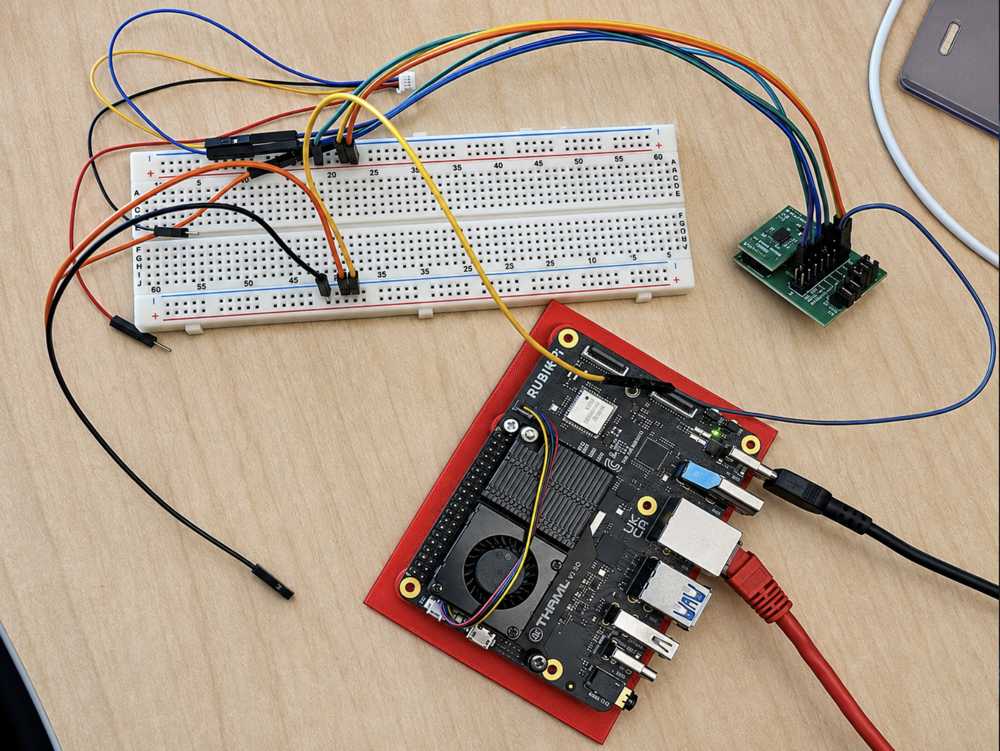

# BMI088 on Qualcomm QCS6490 — RUBIK Pi 3



Bring **Bosch BMI088 inertial sensing to the Qualcomm QCS6490 platform** with
C and Python interfaces, tested on **RUBIK Pi 3 running Ubuntu Server**. Both interfaces use the official Bosch SensorAPI through a shared
Linux I2C backend. Normal operation requires **no root or sudo**.

- Official Bosch driver pinned to a tested commit.
- Python API using standard-library `ctypes`; no pip dependencies.
- Accelerometer in g or m/s² and gyroscope in degrees/s.
- Verified reset handling and exclusive access across C/Python readers.
- Hardware-tested on the Qualcomm QCS6490-based RUBIK Pi 3 (ARM64).
- Automated build and API tests also run without a sensor.

## Qualcomm QCS6490 integration

This project connects a BMI088 accelerometer and gyroscope to **Qualcomm
QCS6490-based hardware** using the Linux I2C userspace interface. **RUBIK Pi 3**
is the reference board used for wiring, device permissions, and hardware testing.

| Layer | Implementation |
| --- | --- |
| Qualcomm platform | **QCS6490**, running ARM64 Linux |
| Verified development board | **RUBIK Pi 3** |
| Operating system | Ubuntu Server |
| Sensor connection | Board header I2C1, exposed as `/dev/i2c-1` |
| Sensor driver | Official Bosch BMI08x SensorAPI |
| Application interfaces | Native C and Python (`ctypes`) |

The adapter uses standard Linux `i2c-dev`, not a Qualcomm-specific sensor SDK.
Other QCS6490 boards require their own pinout, bus mapping, and kernel setup;
compatibility with those boards has not been verified. The header pin numbers
in this repository apply specifically to RUBIK Pi 3.

## Quick start

```bash
git clone --recurse-submodules https://github.com/mauringo/BMI088-QCS6490-RUBIKPI3.git
cd BMI088-QCS6490-RUBIKPI3
```

Inside the checkout, initialize the Bosch dependency and build:

```bash
git submodule update --init --recursive
make
python3 bmi088_read.py
```

Your account must belong to the `i2c` group. On the configured RUBIK Pi, you can
run immediately from an existing SSH session:

```bash
cd ~/BMI088
sg i2c -c 'python3 bmi088_read.py'
```

Stop with **Ctrl+C**. Stop any other reader before starting a new one.

On a fresh Ubuntu installation, the **one-time administrative setup** is:

```bash
sudo apt update
sudo apt install build-essential python3 i2c-tools git
sudo modprobe i2c-dev
sudo groupadd -f i2c
sudo usermod -aG i2c "$USER"
```

Reconnect over SSH and verify that `/dev/i2c-1` belongs to group `i2c` with mode
`0660`. If it does not, follow the [permission setup](docs/guide.md#device-permissions-one-time-setup).
No sudo is needed to build or run afterward.

## Components

| Component | Requirement |
| --- | --- |
| Host board | **RUBIK Pi 3 or a Qualcomm QCS6490-based board** running Linux with an accessible I2C bus. |
| IMU module | [**Seeed Studio Grove – 6-Axis Accelerometer & Gyroscope (BMI088)**](https://www.seeedstudio.com/Grove-6-Axis-Accelerometer-Gyroscope-BMI088.html), SKU **101020584**, with I2C support, configured for accelerometer address `0x18` and gyroscope address `0x68`. |
| Wiring | Leads or a suitable connector cable for **3.3 V, GND, SDA, and SCL**. |
| Power supply | A power supply suitable for the host board. |
| Optional prototyping hardware | Breadboard and jumper wires, as shown in the setup photograph. |

**Verified setup:** RUBIK Pi 3 with Ubuntu Server. Other Qualcomm QCS6490-based
boards need their own header pinout, I2C bus selection, and device permissions;
the RUBIK Pi 3 pin numbers below must not be assumed to apply to them.

## Wiring

**Power off before wiring.** Numbers below are physical header positions.

| BMI088 module | RUBIK Pi pin | Signal |
| --- | ---: | --- |
| 3V / 3V3 | **1** | 3.3 V |
| GND | **6** | Ground |
| SDA | **3** | I2C1 data |
| SCL | **5** | I2C1 clock |

**Pin 1 is 3.3 V. Pins 2 and 4 are 5 V: do not use them for the module's 3V input.**

<details>
<summary>View the wiring photograph and pin diagram</summary>


</details>

This implementation uses `/dev/i2c-1`, accelerometer address `0x18`, and gyroscope
address `0x68`. Expected chip IDs are `0x1e` and `0x0f` respectively.

## Python API

Run your script from this checkout, keeping `bmi088.py` and the built
`libbmi088.so` together:

```python
from bmi088 import BMI088

with BMI088('/dev/i2c-1') as sensor:
    sample = sensor.read()
    print(sample.acceleration_g)        # (x, y, z), including gravity
    print(sample.acceleration_m_s2)     # (x, y, z), m/s²
    print(sample.angular_velocity_dps)  # (x, y, z), degrees/s
```

A stationary sensor normally measures about **1 g in total**, with angular
velocity near zero. Opening the sensor resets and configures both components.
Use a context manager to release the device lock. See the
[full API and lifecycle documentation](docs/guide.md#python-library-api).

## Command-line tools

```bash
python3 bmi088_read.py --probe        # Check IDs without resetting
python3 bmi088_read.py --samples 100  # Finite capture
python3 bmi088_read.py --help
./bmi088 --samples 10                # Equivalent native C reader
```

Prefix a command with `sg i2c -c '…'` if your current session has not picked up
the group membership yet.

## Build and test

Requires Linux, a C compiler, make, Linux I2C headers, and Python **3.10+**.
`build-essential` supplies the compilation dependencies on Ubuntu.
`i2c-tools` is optional for diagnostics. `python3-smbus` was installed for an
earlier prototype and is **not used** by this implementation.

```bash
make                    # Build bmi088 and libbmi088.so
make test               # Tests without hardware; safe for CI
make clean              # Remove generated binaries
```

Rebuild binaries on the target architecture. Git excludes binaries and caches.
The [GitHub Actions workflow](.github/workflows/ci.yml) builds on Linux and tests
Python 3.10 and 3.12. It does not claim to validate physical sensor behavior.

Opt-in hardware regression test (resets the attached sensor):

```bash
sg i2c -c 'make hardware-test'
```

## Behavior and limitations

The configured ranges are **±3 g** and **±500°/s**, with both sensors running at
100 Hz. The CLI polls at about 10 Hz. Reads are sequential, not synchronized;
this is not a lossless recorder. There is no orientation fusion, calibration,
FIFO draining, or automatic gravity removal.

Every initialized session resets the sensors before loading the Bosch
configuration. On the tested board, reset commands may return a NACK after taking
effect. This is accepted only after checking chip IDs and reset-register values.
Other bus errors remain errors. See [implementation details and troubleshooting](docs/guide.md#initialization-reset-handling-and-sampling-limits).

## Documentation

- [Complete guide](docs/guide.md): dependencies and installed versions, permissions,
  wiring, API, troubleshooting, and hardware validation results.
- [Contributing](CONTRIBUTING.md): development and test expectations.
- [Third-party notices](THIRD_PARTY_NOTICES.md): Bosch source provenance.

## License

Project code is licensed under the [MIT License](LICENSE). The Bosch submodule
retains its own [BSD-3-Clause license](vendor/BMI08x_SensorAPI/LICENSE) and
copyright notices. This is an independent integration, not an official Bosch,
Qualcomm, or Thundercomm product.
